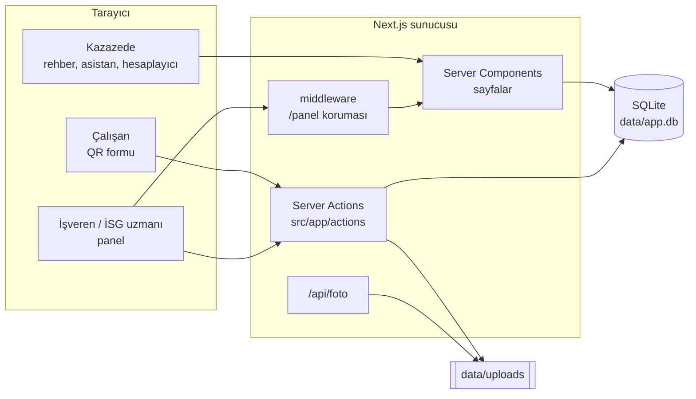
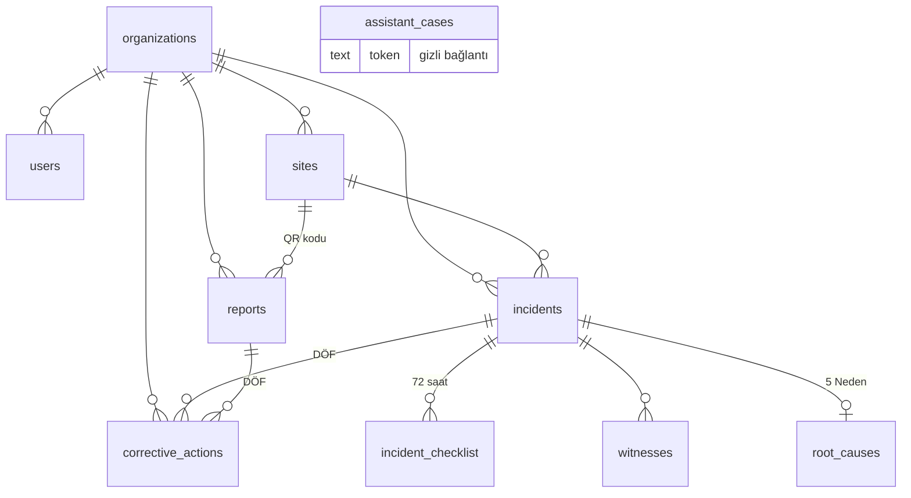

# Geliştirici Rehberi

Bu rehber, kazagecirdim.com kod tabanında çalışacak yazılımcılar içindir. Ürünün ne yaptığını, kodun nasıl düzenlendiğini, uyulması gereken kuralları ve sık yapılan değişikliklerin nasıl yapılacağını anlatır.

Hızlı kurulum için [README](../README.md) yeterlidir. Bu belge, kodu değiştirmeden önce bilinmesi gerekenleri kapsar.

**İçindekiler**

1. [Ürünü bir paragrafta anlamak](#1-ürünü-bir-paragrafta-anlamak)
2. [Kurulum](#2-kurulum)
3. [Mimari](#3-mimari)
4. [Klasör yapısı](#4-klasör-yapısı)
5. [Veri modeli](#5-veri-modeli)
6. [Kimlik doğrulama ve kurum izolasyonu](#6-kimlik-doğrulama-ve-kurum-izolasyonu)
7. [Kod yazma kuralları](#7-kod-yazma-kuralları)
8. [Sık yapılan değişiklikler: tarifler](#8-sık-yapılan-değişiklikler-tarifler)
9. [Tarih, saat ve iş günü](#9-tarih-saat-ve-iş-günü)
10. [Dosya yükleme](#10-dosya-yükleme)
11. [Test](#11-test)
12. [Yayına alma](#12-yayına-alma)
13. [Güvenlik ve KVKK kontrol listesi](#13-güvenlik-ve-kvkk-kontrol-listesi)
14. [Bilinen eksikler ve yol haritası](#14-bilinen-eksikler-ve-yol-haritası)
15. [Git akışı](#15-git-akışı)
16. [Sorun giderme](#16-sorun-giderme)

---

## 1. Ürünü bir paragrafta anlamak

Kaza geçiren kişi, aile ve çalışanlar siteyi **ücretsiz** kullanır: rehberler, kişisel yapılacaklar listesi (asistan) ve ödenek hesaplayıcı. Parayı **işverenler** öder: çalışanların QR kodla ramak kala bildirdiği bir platform ve iş kazası olduğunda SGK süresini, 72 saatlik listeyi, tanık ifadelerini ve kök neden analizini yöneten bir kaza dosyası.

Bu ayrım kodda da var:

| Taraf | Giriş | Kod | Veri sahibi |
| --- | --- | --- | --- |
| Herkese açık site | Yok | `src/app/(site)` | Yok (asistan listeleri hariç) |
| QR bildirim formu | Yok | `src/app/b/[code]` | Formun ait olduğu kurum |
| İşveren paneli | Gerekli | `src/app/panel` | Oturumdaki kurum (`orgId`) |

## 2. Kurulum

Gereksinimler: **Node.js 20+** ve npm. `better-sqlite3` yerel (native) bir modüldür; Windows'ta derleme hatası alırsanız Node'un LTS sürümünü kullanın veya WSL'de çalışın.

```bash
git clone https://github.com/lprslnylmz-dot/kazagecirdim.git
cd kazagecirdim
npm install
cp .env.example .env
npm run seed        # demo kurum, kullanıcı, bildirim ve kaza dosyası
npm run dev         # http://localhost:3000
```

| Demo | Değer |
| --- | --- |
| Giriş | `demo@kazagecirdim.com` / `demo12345` |
| QR formu | http://localhost:3000/b/demo-fabrika |
| Veritabanı | `data/app.db` (silerseniz ilk istekte boş olarak yeniden oluşur) |

### Ortam değişkenleri

| Değişken | Zorunlu | Varsayılan | Açıklama |
| --- | --- | --- | --- |
| `SESSION_SECRET` | Üretimde evet | Geliştirmede sabit bir anahtar | Oturum çerezini imzalar. En az 32 karakter. Üretimde yoksa giriş hata verir. |
| `PUBLIC_BASE_URL` | Üretimde önerilir | İstek başlıklarından çıkarılır | QR kodlardaki adres. `https://` ile başlıyorsa çerez `secure` olur. |
| `DATABASE_PATH` | Hayır | `data/app.db` | SQLite dosyası |
| `UPLOAD_DIR` | Hayır | `data/uploads` | Bildirim fotoğrafları |

### npm komutları

| Komut | Ne yapar |
| --- | --- |
| `npm run dev` | Geliştirme sunucusu |
| `npm run build` / `npm start` | Üretim derlemesi ve sunucusu |
| `npm test` | Birim testleri (vitest) |
| `npm run typecheck` | TypeScript kontrolü |
| `npm run seed` | Demo verisi (zaten varsa atlar) |

## 3. Mimari

Uygulama tek bir **Next.js 15 (App Router)** projesidir. Ayrı bir backend veya REST API yoktur: sayfalar sunucuda render edilir, veri yazan her işlem bir **server action**'dır. Tek API route, yetki kontrolü gereken fotoğraf servisidir.



| Katman | Teknoloji | Neden |
| --- | --- | --- |
| Arayüz | React 19, Tailwind CSS v4 | Sunucu bileşenleri az JS gönderir; QR formu eski telefonlarda da hızlı açılmalı |
| Form işlemleri | Server Actions + `useActionState` | Form, JS yüklenmeden de çalışır; ayrı API yazmaya gerek yok |
| Doğrulama | zod | Her girdi sunucuda doğrulanır |
| Veritabanı | SQLite + Drizzle ORM | Tek dosya, kurulumsuz; Drizzle ile ileride PostgreSQL'e geçiş kolay |
| Oturum | jose (JWT) + bcryptjs | İmzalı, httpOnly çerez; ek servis gerektirmez |
| QR | qrcode | Afiş SVG olarak sunucuda üretilir |

## 4. Klasör yapısı

```
src/
├── app/
│   ├── (site)/                 Herkese açık site. Parantezli klasör URL'ye eklenmez.
│   │   ├── layout.tsx          Acil durum bandı + üst menü + alt bilgi
│   │   ├── page.tsx            "Ne tür bir kaza geçirdiniz?"
│   │   ├── kaza/[tur]/         Rehber sayfaları (statik üretilir)
│   │   ├── asistan/            Liste oluşturma + /asistan/[token] kişisel liste
│   │   ├── hesaplayici/        Ödenek hesaplayıcı (istemci bileşeni)
│   │   ├── isveren/            Satış sayfası ve fiyatlar
│   │   └── giris/, kayit/      İşveren girişi ve kaydı
│   ├── b/[code]/               Çalışanın QR ile açtığı bildirim formu (mobil, girişsiz)
│   ├── panel/                  İşveren paneli (giriş zorunlu)
│   │   ├── layout.tsx          Oturum kontrolü + panel menüsü
│   │   ├── page.tsx            Özet: SGK uyarıları, sayılar, son bildirimler
│   │   ├── olaylar/            Kaza dosyaları: liste, yeni, detay, yazdırılabilir rapor
│   │   ├── bildirimler/        Ramak kala bildirimleri ve DÖF
│   │   ├── rapor/              Aylık İSG raporu
│   │   └── lokasyonlar/        Lokasyonlar ve QR afişleri
│   ├── actions/                Tüm server action'lar
│   │   ├── auth.ts             kayıt, giriş, çıkış
│   │   ├── assistant.ts        asistan listesi
│   │   ├── reports.ts          bildirimler, DÖF, lokasyon
│   │   └── incidents.ts        kaza dosyası işlemleri
│   ├── api/foto/[name]/        Fotoğraf servisi (kurum kontrolüyle)
│   ├── globals.css             Tema renkleri ve ortak sınıflar (btn, card, field…)
│   └── layout.tsx              <html lang="tr">
├── components/                 Ortak bileşenler (rozetler, DÖF listesi, formlar)
├── lib/
│   ├── schema.ts               Drizzle şeması + tabloları oluşturan SQL
│   ├── db.ts                   Tek veritabanı bağlantısı
│   ├── auth.ts                 Oturum oluşturma/okuma, requireSession()
│   ├── content.ts              Rehber metinleri ve asistan kontrol listeleri
│   ├── labels.ts               Kategoriler, durumlar, işveren 72 saat listesi
│   ├── workdays.ts             İş günü ve SGK son gün hesabı
│   ├── odenek.ts               Geçici iş göremezlik ödeneği hesabı
│   ├── report-stats.ts         Aylık rapor hesapları
│   ├── uploads.ts              Görsel doğrulama ve kaydetme
│   ├── format.ts               Tarih, para, rastgele kod
│   └── base-url.ts             Sitenin tam adresi
└── middleware.ts               Çerezi olmayanı /panel'den /giris'e yönlendirir
scripts/seed.ts                 Demo verisi
tests/
├── logic.test.ts               Birim testleri
└── e2e.py                      Uçtan uca tarayıcı testi (Playwright, Python)
```

**Kural:** İş mantığı (hesaplama, süre, istatistik) `src/lib` altında, veritabanına ve Next.js'e bağımlı olmayan saf fonksiyonlar olarak yazılır. Böylece birim testi kolaydır. Sayfalar ve action'lar bu fonksiyonları çağırır.

## 5. Veri modeli



| Tablo | Ne tutar | Not |
| --- | --- | --- |
| `organizations` | Müşteri kurum | `plan`: pilot, temel, profesyonel, kurumsal (henüz faturalamaya bağlı değil) |
| `users` | Panel kullanıcıları | `role` alanı var ama henüz yetkiye bağlı değil |
| `sites` | Lokasyon | `code` QR adresidir (`/b/<code>`); tahmin edilemez olmalı |
| `reports` | Ramak kala / güvensizlik bildirimi | `reporter_name` boşsa anonim |
| `incidents` | İş kazası dosyası | `sgk_deadline` oluşturulurken hesaplanıp saklanır |
| `incident_checklist` | 72 saat maddeleri | Dosya açılırken `labels.ts`'teki listeden kopyalanır |
| `witnesses` | Tanık ifadeleri | |
| `root_causes` | 5 Neden analizi | Kaza başına tek kayıt (`incident_id` birincil anahtar) |
| `corrective_actions` | Düzeltici/önleyici faaliyet | Ya bir kazaya ya bir bildirime bağlı |
| `assistant_cases` | Kazazedenin kişisel listesi | Kuruma bağlı değil; yalnız `token` ile açılır |

Tarihler metin olarak saklanır:

- Zaman damgaları (`created_at`, `closed_at`…): ISO, UTC (`2026-10-30T12:00:00.000Z`).
- Yalnız gün olanlar (`sgk_deadline`, `due_date`, `accident_date`): `YYYY-AA-GG`.
- `incidents.occurred_at`: formdan gelen yerel saat, `YYYY-AA-GGTSS:DD` (Türkiye saati, saat dilimi eki yok). Ayrıntı için [bölüm 9](#9-tarih-saat-ve-iş-günü).

### Şema değişikliği

Şu an migration aracı yok. Tablolar `schema.ts` içindeki `BOOTSTRAP_SQL` ile `CREATE TABLE IF NOT EXISTS` olarak oluşturulur. Bu, **yeni tablo** eklemek için yeterlidir ama **var olan tabloya sütun eklemeyi uygulamaz**.

Bir sütun eklerken:

1. `schema.ts` içinde Drizzle tanımına ve `BOOTSTRAP_SQL`'e ekleyin.
2. Geliştirmede `data/app.db`'yi silip `npm run seed` çalıştırın.
3. Yayındaki veritabanı için elle `ALTER TABLE … ADD COLUMN …` çalıştırın ve bunu PR açıklamasına yazın.

İlk ödeme yapan müşteriden önce `drizzle-kit` ile gerçek migration'lara geçilmelidir ([yol haritası](#14-bilinen-eksikler-ve-yol-haritası)).

## 6. Kimlik doğrulama ve kurum izolasyonu

Bu bölüm kodun en kritik kuralını içerir. **Bir kurum başka bir kurumun verisini asla görmemeli.** Kaza ve sağlıkla ilgili veriler söz konusu olduğu için bir sızıntı hem KVKK ihlali hem ticari felakettir.

### Oturum nasıl çalışır

1. Giriş veya kayıtta `createSession()` imzalı bir JWT'yi `kg_session` adlı httpOnly çereze yazar (14 gün).
2. `middleware.ts` yalnızca çerezin **varlığına** bakar ve çerezsiz istekleri `/giris`'e yollar. Bu bir ön elemedir, güvenlik kontrolü değildir.
3. Asıl kontrol `requireSession()` içindedir: imzayı doğrular, kullanıcının hâlâ var olduğunu ve kurumunun değişmediğini veritabanından teyit eder.

### Kurallar

- Panel altındaki **her sayfa** ve **her server action** `requireSession()` çağırarak başlar. Layout'taki kontrol yeterli değildir; server action'lar layout'u atlayarak doğrudan çağrılabilir.
- Kurum verisi okuyan veya yazan **her sorgu** `orgId` ile filtrelenir. ID ile tek kayıt getirirken bile:

```ts
// DOĞRU
const r = db.select().from(schema.reports)
  .where(and(eq(schema.reports.id, id), eq(schema.reports.orgId, s.orgId)))
  .get();
if (!r) notFound();

// YANLIŞ: başka kurumun bildirim ID'sini tahmin eden herkes görür
const r = db.select().from(schema.reports).where(eq(schema.reports.id, id)).get();
```

- Alt kayıtlar (tanık, kontrol maddesi, kök neden) kendi `orgId`'sini tutmaz. Bunlara yazmadan önce bağlı oldukları kazanın kuruma ait olduğunu doğrulayın. `incidents.ts` içindeki `ownIncident()` yardımcısı bunu yapar.
- Formdan gelen `orgId`'ye asla güvenmeyin. Kurum her zaman oturumdan (`s.orgId`) alınır.
- Kayıt bulunamadığında ve başka kuruma ait olduğunda **aynı** yanıt verilir (404). Kaydın var olduğu bilgisi de sızmamalıdır.
- Giriş hatasında "kullanıcı yok" ile "şifre yanlış" ayrımı yapılmaz.

Uçtan uca test, ikinci bir kurum oluşturup birinci kurumun kaza ve bildirimine erişmeyi dener ve 404 bekler. Yeni bir panel sayfası eklerseniz bu teste de bir satır ekleyin.

### Girişsiz yüzeyler

| Yüzey | Nasıl korunuyor |
| --- | --- |
| `/b/[code]` QR formu | Lokasyon kodu 6 baytlık rastgele değer; form yalnız **yazar**, hiçbir kurum verisini göstermez. Bot tuzağı alanı (`website`) var. |
| `/asistan/[token]` | 12 baytlık rastgele token; arama motorlarına kapalı (`robots: noindex`). Kişiye "bağlantıyı kaydedin" uyarısı gösterilir. |
| `/api/foto/[name]` | Oturum + fotoğrafın oturumdaki kuruma ait bir bildirime bağlı olması şartı. |

## 7. Kod yazma kuralları

### Genel

- **Dil:** Kullanıcıya görünen her metin Türkçedir. Kod içi adlar İngilizce veya Türkçe olabilir, ama bir dosyanın içinde tutarlı olun. Veritabanı durum değerleri Türkçe ve ASCII'dir (`yeni`, `kapandi`, `acik`); ekranda gösterilecek karşılıkları `labels.ts`'tedir.
- **TypeScript strict** açıktır. `any` kullanmayın; `npm run typecheck` temiz olmalı.
- Sabit etiketleri, kategorileri ve listeleri kodun içine gömmeyin; `labels.ts` veya `content.ts`'e koyun.

### Server action kalıbı

Her server action aynı sırayı izler:

```ts
"use server";

export async function birIslem(formData: FormData) {
  const s = await requireSession();                           // 1. Oturum (panel işlemleriyse)
  const d = Sema.safeParse(Object.fromEntries(formData));     // 2. zod ile doğrulama
  if (!d.success) return { error: "…", values: … };
  const kayit = /* orgId ile sahiplik kontrolü */;            // 3. Sahiplik
  if (!kayit) return;
  db.update(…).where(and(eq(…id), eq(…orgId, s.orgId))).run(); // 4. Yazma
  revalidatePath(`/panel/…`);                                 // 5. Sayfayı tazele
}
```

- Birden fazla tabloya yazıyorsanız `db.transaction()` kullanın (örnek: `createIncident`, `register`).
- Metin alanlarına bir üst uzunluk sınırı koyun (`.max()` veya `.slice()`).
- Yazdıktan sonra etkilenen sayfalar için `revalidatePath` çağırın; aksi halde ekran eski veriyi gösterebilir.

### Formlar ve React 19'un form sıfırlaması

React 19, bir server action'a gönderilen formu işlem bitince **sıfırlar**. Bu iki soruna yol açar ve ikisi de kodda çözülmüştür:

1. **Hata olunca kullanıcının yazdıkları kaybolur.** Çözüm: action hata dönerken girilen değerleri de `values` olarak geri döner; form bunları `defaultValue` olarak kullanır ve `key={JSON.stringify(values)}` ile yeniden çizilir. Örnek: `src/components/auth-forms.tsx`, `src/app/b/[code]/report-form.tsx`. Şifre alanı asla geri dönmez.
2. **Kaydedilen değer yerine eski değer görünür.** Çözüm: kayıtlı veriyi gösteren formlara o veriden türeyen bir `key` verilir. Örnek: `<form key={rc?.updatedAt ?? "yeni"} …>`.

Yeni bir form yazarken bu iki kalıptan uygun olanı kullanın.

### Arayüz

- Ortak sınıflar `globals.css` içinde `@utility` olarak tanımlıdır: `btn-primary`, `btn-secondary`, `btn-danger`, `btn-sm`, `card`, `field`, `label`, `hint`, `h1`, `h2`, `badge`. Yeni bir düğme stili icat etmeden önce bunlara bakın.
- Renkler tema değişkenidir (`brand`, `alert`, `warn`, `ok`, `muted`, `line`, `paper`). Doğrudan hex renk yazmayın.
- Kırmızı (`alert`) yalnız acil durum, süre aşımı ve kaza açma için kullanılır. Her yere kırmızı konursa SGK uyarısı fark edilmez.
- Yazdırılacak sayfalarda yazdırmada gizlenecek öğelere `no-print` sınıfı verin.
- Her form alanının bir `<label htmlFor>`'u olmalı. QR formu eldivenle ve tek elle kullanılabilecek kadar büyük dokunma alanlarına sahip olmalı.

### İçerik ve hukuk

- Rehber metinleri **genel bilgilendirmedir**. "Şunu yapmalısınız, kesin kazanırsınız" gibi kişiye özel hukuki veya tıbbi tavsiye yazmayın.
- Avukata yönlendirme ücretsiz ve tarafsız olmalıdır (ör. baroların adli yardım büroları). Avukatlık reklam yasağı nedeniyle belirli bir avukata veya büroya ücretli yönlendirme **eklenmez**.
- Sitede değer kaybı takipçiliği veya "vekalet verin biz alalım" hizmeti **eklenmez**.
- Mevzuata dayanan bir metni değiştirdiğinizde kaynağı PR açıklamasına yazın ve `content.ts` başındaki "son gözden geçirme" tarihini güncelleyin.

## 8. Sık yapılan değişiklikler: tarifler

### Rehbere madde veya bölüm eklemek

`src/lib/content.ts` içindeki ilgili kaza türünün `sections` dizisine ekleyin. Sayfa kendiliğinden güncellenir.

### Asistan kontrol listesine madde eklemek

Aynı dosyada `checklist` dizisine ekleyin:

```ts
{ key: "ekspertiz-itiraz", label: "…", dueDays: 5, approximate: true, detail: "…" }
```

- `key` o liste içinde benzersiz olmalı (test kontrol eder). Yayındaki kullanıcıların işaretlediği maddeler `key` ile saklandığı için **var olan bir `key`'i değiştirmeyin.**
- `dueDays` kaza tarihinden itibaren takvim günüdür. Kesin yasal süre değil de öneriyse `approximate: true` verin; ekranda "Öneri:" yazar.
- İş günüyle hesaplanması gereken süreler (ör. 3 iş günü) için `dueDays` yaklaşık kalır. Kesinlik gerekiyorsa `scheduleChecklist` içinde `addWorkdays` kullanın.

### Yeni kaza türü eklemek

1. `content.ts`'te `AccidentType` tipine ve `GUIDES` nesnesine ekleyin.
2. Ana sayfadaki `ICON` nesnesine bir simge ekleyin (`src/app/(site)/page.tsx`).
3. Sayfa ve asistan seçeneği otomatik oluşur; `npm run build` ile statik sayfanın üretildiğini kontrol edin.

### Bildirim kategorisi veya türü eklemek

`labels.ts` içindeki `REPORT_CATEGORIES` veya `REPORT_KINDS`'a ekleyin. Doğrulama (zod) ve form bu listelerden üretilir. Var olan bir değeri **silmeyin veya yeniden adlandırmayın**: eski kayıtlar o değeri taşıyor.

### İşverenin 72 saat listesine madde eklemek

`labels.ts` içindeki `INCIDENT_CHECKLIST`'e ekleyin. Yalnız **yeni açılan** kaza dosyalarına yansır; liste dosya açılırken kopyalanır. Eski dosyalara eklemek gerekiyorsa tek seferlik bir betik yazın.

Bir madde başka bir alanla eşleşiyorsa (`sgk` ↔ `incidents.sgk_notified_at`, `kolluk` ↔ `police_notified_at`, `kokneden` ↔ kök neden kaydı) eşleme `incidents.ts` içindedir; yeni eşleme eklerken iki yönü de güncelleyin.

### Panele yeni sayfa eklemek

1. `src/app/panel/<ad>/page.tsx` oluşturun. İlk satır `const s = await requireSession();` olmalı.
2. Tüm sorguları `s.orgId` ile filtreleyin.
3. Menüye eklemek için `src/app/panel/layout.tsx` içindeki `NAV` dizisini güncelleyin.
4. `tests/e2e.py`'deki kurumlar arası erişim kontrolüne bu sayfayı ekleyin.

### Yeni bir hesaplama eklemek

`src/lib` altında saf bir fonksiyon olarak yazın, `tests/logic.test.ts`'e testini ekleyin, sonra sayfadan çağırın. Ödenek hesabı (`odenek.ts`) iyi bir örnektir.

## 9. Tarih, saat ve iş günü

Bu ürünün en kolay hata yapılabilecek yeri burasıdır: SGK son günü bir gün kayarsa işveren para cezası yer.

### Kurallar

- Kullanıcıya gösterilen her tarih **Europe/Istanbul** saatine göredir. `format.ts`'teki `fmtDate`, `fmtDateTime` ve `todayIstanbul` kullanın; `new Date().toLocaleDateString()`'i saat dilimi vermeden çağırmayın. Sunucu UTC'de çalışabilir.
- Formdaki `datetime-local` değeri (`2026-10-30T15:00`) **Türkiye saatidir**. Zaman damgasına çevirmek için `parseIstanbulLocal()` kullanın.
- `YYYY-AA-GG` biçimindeki bir tarihi `new Date("2026-11-02")` ile ayrıştırmayın: bu UTC gece yarısı olarak yorumlanır ve bazı saat dilimlerinde bir önceki güne kayar. `workdays.ts` ve `content.ts` tarihi parçalarına ayırıp yerel tarih oluşturur; aynısını yapın.

### SGK son günü

`sgkDeadline(occurredAt)`: kaza günü sayılmadan, sonraki 3 **iş günü**. Hafta sonu, sabit tarihli resmi tatiller ve `VARIABLE_HOLIDAYS` listesindeki bayramlar atlanır. SGK'nın kendi örnekleri (pazartesi → perşembe, çarşamba → pazartesi) testlerde var.

> **Her yıl yapılacak iş:** `src/lib/workdays.ts` içindeki `VARIABLE_HOLIDAYS` listesine gelecek yılın Ramazan ve Kurban Bayramı tarihlerini ekleyin ve test yazın. Şu an yalnız 2026 girilidir. Arife günleri yarım gün olduğu için listede yoktur; bu bir hukuki yorumdur, değiştirmeden önce bir uzmana danışın.

Son gün kaza dosyası açılırken hesaplanıp saklanır. Tatil listesi sonradan değişirse eski dosyalar güncellenmez.

## 10. Dosya yükleme

`src/lib/uploads.ts`:

- En fazla 5 MB (`next.config.ts`'te server action gövde sınırı 6 MB).
- Tür, uzantıdan veya tarayıcının söylediği MIME'dan değil, **dosyanın ilk baytlarından** belirlenir. Yalnız JPG, PNG, WEBP kabul edilir. SVG kabul edilmez (içinde script olabilir).
- Dosya adı rastgele UUID'dir; kullanıcının verdiği ad hiçbir yerde kullanılmaz.
- Dosyalar web kökünün dışında (`data/uploads`) durur ve yalnız `/api/foto/[name]` üzerinden, yetki kontrolüyle sunulur. `safeUploadPath()` yalnız bizim ürettiğimiz biçimdeki adları kabul ederek dizin dışına çıkmayı engeller.

Bilinen eksik: fotoğrafların EXIF verisi (konum dahil) silinmiyor. Canlıdan önce `sharp` ile yeniden kodlayarak temizlenmeli.

## 11. Test

### Birim testleri

```bash
npm test
```

`tests/logic.test.ts`: SGK son günü (tatiller dahil), ödenek hesabı, aylık rapor hesapları, asistan tarihleri, yükleme güvenliği. Saf fonksiyonlar test edilir; veritabanı gerekmez.

**`src/lib` altında değiştirdiğiniz her hesaplama için test yazın.** Özellikle tarih ve para hesaplarında.

### Uçtan uca test

Gerçek bir tarayıcıyla kazazede akışını, QR bildirimini (geçerli ve zararlı dosya), girişi, kaza dosyasını, raporları ve kurumlar arası erişimi dener.

```bash
pip install playwright && python -m playwright install chromium   # bir kez

rm -f data/app.db* && rm -rf data/uploads && npm run seed
npm run build
SESSION_SECRET=$(openssl rand -base64 48) npx next start -p 3100 &
python3 tests/e2e.py          # "E2E OK" yazmalı
```

`BASE_URL` ile başka bir adres, `SHOTS_DIR` ile ekran görüntülerinin yazılacağı klasör verilebilir. Test boş bir veritabanı varsayar (demo verisi + kendi oluşturdukları); her çalıştırmadan önce veritabanını sıfırlayın.

### PR öncesi kontrol

```bash
npm run typecheck && npm test && npm run build
```

Ekranı değiştirdiyseniz uçtan uca testi de çalıştırın ve mobil genişlikte (390 px) QR formuna bakın.

## 12. Yayına alma

### Nereye

Uygulama **kalıcı diski olan** bir sunucuda çalışmalıdır, çünkü SQLite veritabanı ve fotoğraflar diske yazılır.

| Uygun | Uygun değil |
| --- | --- |
| Bir VPS (Hetzner, DigitalOcean, Türkiye'de bir sağlayıcı) üzerinde Node + systemd veya Docker | Vercel, Netlify gibi sunucusuz (serverless) platformlar: disk her istekte sıfırlanır, veri kaybolur |
| Kalıcı volume bağlanmış Railway, Fly.io, Render | |

KVKK açısından sağlık verisi içerebilecek kayıtlar için **Türkiye'de barındırma** tercih edilmelidir; yurt dışına aktarım ayrı yükümlülükler doğurur.

### Adımlar

```bash
npm ci
npm run build
SESSION_SECRET="…" PUBLIC_BASE_URL="https://kazagecirdim.com" \
DATABASE_PATH=/var/lib/kazagecirdim/app.db UPLOAD_DIR=/var/lib/kazagecirdim/uploads \
npm start          # varsayılan port 3000
```

- Önüne HTTPS sonlandıran bir ters vekil (Caddy veya Nginx) koyun.
- `PUBLIC_BASE_URL` mutlaka `https://` ile verilmeli. Hem QR kodlar doğru adresi gösterir hem çerez `secure` olur.
- `data/` klasörünü (veya verdiğiniz yolları) **her gün yedekleyin**. SQLite için çalışan sistemde güvenli yedek: `sqlite3 app.db ".backup 'yedek.db'"`.
- QR kodları basıldıktan sonra **alan adını ve `/b/` yolunu değiştirmeyin**; duvardaki afişler çalışmaz hale gelir.

### Ölçek

SQLite (WAL modunda) tek sunucuda yüzlerce kurumu rahat taşır. Birden fazla uygulama sunucusuna çıkmak gerektiğinde PostgreSQL'e geçilir; Drizzle sorguları büyük ölçüde aynı kalır, değişen `schema.ts` (`pg-core`) ve `db.ts`'tir. Server action'lar `.get()`/`.all()`/`.run()` yerine `await` ile çağrılacak biçime getirilmelidir.

## 13. Güvenlik ve KVKK kontrol listesi

Canlıya çıkmadan önce tamamlanmalı:

- [ ] `SESSION_SECRET` güçlü ve gizli; depoda veya istemci kodunda yok
- [ ] HTTPS zorunlu, `PUBLIC_BASE_URL` https
- [ ] QR formu ve giriş için oran sınırlama (rate limit); gerekirse CAPTCHA
- [ ] Giriş denemelerinde kilitleme veya gecikme
- [ ] Yüklenen fotoğraflardan EXIF/konum verisinin silinmesi
- [ ] Güvenlik başlıkları (CSP, HSTS, X-Frame-Options) `next.config.ts` veya ters vekilde
- [ ] Aydınlatma metni ve açık rıza metinleri gerçek içerikle (kayıt formundaki onay kutusu şu an bir metne bağlı değil)
- [ ] VERBİS kaydı gerekliliği değerlendirildi
- [ ] Veri saklama süreleri ve silme işlemi tanımlandı (kurum hesabını kapatınca veriler ne olacak?)
- [ ] Günlük yedekleme ve geri yükleme denendi
- [ ] Hata kayıtlarında (log) kişisel veri yok
- [ ] Bağımlılık güvenlik taraması (`npm audit`) temiz veya bilinen istisnalar belgelendi

Kod incelemesinde her değişiklik için sorulacak üç soru:

1. Bu sorgu `orgId` ile filtreleniyor mu?
2. Bu girdi zod ile doğrulanıyor ve uzunluğu sınırlı mı?
3. Bu ekran, gerekmeyen bir kişisel veya sağlık verisi istiyor ya da gösteriyor mu?

## 14. Bilinen eksikler ve yol haritası

Öncelik sırasıyla:

| # | İş | Neden | Nereden başlanır |
| --- | --- | --- | --- |
| 1 | SGK son günü için e-posta/SMS hatırlatıcı | Ürünün en somut değer önerisi | Günlük çalışan bir görev; `incidents` içinde `sgk_notified_at IS NULL` ve `sgk_deadline` yarın/bugün olanlar |
| 2 | Oran sınırlama ve EXIF temizliği | Canlı öncesi güvenlik | `src/app/actions/reports.ts`, `src/lib/uploads.ts` |
| 3 | Gerçek migration'lar (`drizzle-kit`) | Canlı veritabanında şema değişikliği | `schema.ts` |
| 4 | Kuruma kullanıcı davet etme ve roller | Birden fazla İSG uzmanı | `users.role` hazır |
| 5 | Abonelik ve ödeme (iyzico vb.) | Gelir | `organizations.plan` hazır |
| 6 | OSGB görünümü | Toptan lisans kanalı: bir OSGB kullanıcısı birden çok kurumu yönetir | Kullanıcı–kurum ilişkisini çoka çok yapmak gerekir |
| 7 | Asistan için belge kasası ve hatırlatıcı | Kazazedeyi geri getirmek | KVKK açısından sağlık verisi; önce hukuki görüş |
| 8 | Sigorta ve ürün ortaklık bileşeni | B2C gelir | Rehber sayfalarına bir bileşen |
| 9 | Ödeme yapan ilk müşteriden önce PostgreSQL değerlendirmesi | Yedekleme ve ölçek | [bölüm 12](#ölçek) |

Bilinen küçük eksikler:

- `users.role` yetkiye bağlı değil; tüm kullanıcılar admin gibi davranır.
- Kayıt formundaki KVKK onay kutusu bir metne bağlantı vermiyor.
- `VARIABLE_HOLIDAYS` yalnız 2026'yı içeriyor.
- Panelde lokasyon silme/yeniden adlandırma yok (bilinçli: basılmış QR'lar bozulmasın diye silme yerine "pasif" durumu eklenmeli).
- Aylık rapor kazaları `occurred_at` gününe göre, bildirimleri UTC zaman damgasına göre ayın sınırına yerleştiriyor; ay sınırında gece yarısına yakın bir bildirim komşu aya düşebilir.

## 15. Git akışı

- `main` her zaman yayına alınabilir durumda olmalı. Doğrudan `main`'e itmeyin.
- Her iş için bir dal açın: `ozellik/sgk-hatirlatici`, `duzeltme/qr-form-foto`, `icerik/trafik-rehberi`.
- Commit mesajları Türkçe, emir kipinde ve kısa: `SGK son gün hatırlatıcısını ekle`.
- PR açıklamasında: ne değişti, neden, nasıl test edildi; şema değiştiyse çalıştırılacak SQL; mevzuat metni değiştiyse kaynak.
- Bir PR'ı birleştirmeden önce [PR öncesi kontrol](#pr-öncesi-kontrol) komutları geçmeli.
- `.env`, `data/`, veritabanı dosyaları ve yüklenen fotoğraflar **asla** depoya girmez (`.gitignore` bunları dışarıda tutar). Gerçek müşteri verisini test için yerel makineye kopyalamayın.

## 16. Sorun giderme

| Belirti | Neden | Çözüm |
| --- | --- | --- |
| Girişten sonra tekrar giriş sayfasına dönüyor | Çerez `secure` ama site http üzerinden açılmış | `PUBLIC_BASE_URL`'i sitenin gerçek adresiyle (http veya https) eşleştirin |
| `SESSION_SECRET en az 32 karakter olmalı` | Üretim modunda anahtar yok | `.env` veya ortam değişkeni olarak verin |
| `better-sqlite3` kurulumu başarısız | Yerel modül derlenemedi | Node LTS kullanın; Linux'ta `build-essential` ve `python3` kurun |
| Yeni sütun "no such column" hatası veriyor | `CREATE TABLE IF NOT EXISTS` var olan tabloyu değiştirmez | [Şema değişikliği](#şema-değişikliği) |
| QR kod `localhost` adresini gösteriyor | `PUBLIC_BASE_URL` verilmemiş | Ortam değişkenini ayarlayın |
| Kaydettikten sonra form eski değeri gösteriyor | React 19 form sıfırlaması | Forma kayıtlı veriden türeyen bir `key` verin ([bölüm 7](#formlar-ve-react-19un-form-sıfırlaması)) |
| SGK son günü bir gün kaymış görünüyor | Tarih UTC olarak ayrıştırılmış | [Bölüm 9](#9-tarih-saat-ve-iş-günü) kuralları |
| Uçtan uca test girişte takılıyor | Veritabanı önceki çalıştırmadan kalmış veya sunucu `SESSION_SECRET`'siz başlamış | Veritabanını sıfırlayıp `SESSION_SECRET` ile yeniden başlatın |

---

Bu rehber kodla birlikte yaşar. Mimariyi, bir kuralı veya kurulumu değiştiren her PR, ilgili bölümü de güncellemelidir.
